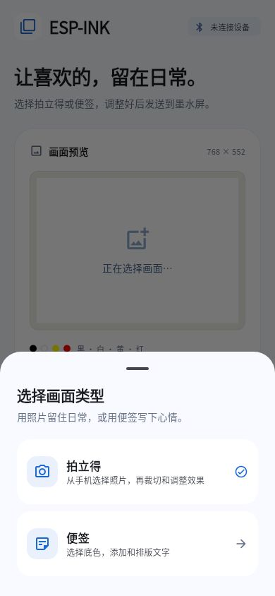

# ESP-INK · Flutter Android

四彩墨水屏的 Android 伴侣应用。界面采用 Google Material 3：浅色、蓝色主色、柔和圆角和三栏导航。源码位于本仓库，设备通过B2协议连接；接口参考见 `docs/reference/B2/`。

源码、实际编译目录、安装包、设备固件及文档均集中在本APP目录，不使用软链接。当前版本为 **1.0.7+8**，安装包为 `releases/ESP-INK-1.0.7-android.apk`。本版配合 **ESP_INK B2.0.1**，在物理刷屏期间继续读取图库缩略图和高清，读图进度不覆盖刷屏状态；存并显示时严格验证追加身份并保留旧高清缓存。旧B2.0.0继续兼容，但需等刷屏结束再读取新图。模式选择、C1/C2、自动效果、删图缓存保留及MTU517限长修复继续保留。见[交付说明](docs/交付说明.md)、[刷屏期间读取图库](docs/刷屏期间读取图库.md)和[验证记录](docs/VERIFICATION.md)。

## 下载与仓库

- [最新安装包与源码归档](https://github.com/robbie-ht/ESP-INK-for-Andriod/releases/tag/v1.0.7)：ESP-INK 1.0.7，Android 7.0及以上；安装包为测试签名。
- [直接下载APK](https://github.com/robbie-ht/ESP-INK-for-Andriod/releases/download/v1.0.7/ESP-INK-1.0.7-android.apk)、[完整源码压缩包](https://github.com/robbie-ht/ESP-INK-for-Andriod/releases/download/v1.0.7/ESP-INK-Flutter-source.tar.gz)、[成品SHA256](https://github.com/robbie-ht/ESP-INK-for-Andriod/releases/download/v1.0.7/SHA256SUMS)。
- [B2.0.1 OTA应用镜像](https://github.com/robbie-ht/ESP-INK-for-Andriod/releases/download/v1.0.7/ESP_INK-B2.0.1-app.bin)：已有B2分区使用，完整源码与构建脚本在firmware/B2.0.1/source。
- 克隆后可按下方Docker步骤构建。仓库包含源码、字体许可、文档、测试、Gradle wrapper及验证记录；`build/`和`releases/`在本地保留，由Git忽略。下载文件放入本地`releases/`后，交付文档中的成品相对链接即可使用。

ESP-INK 1.0.7继续使用1.0.4至1.0.6的应用ID `io.github.robbieht.espink`，相同签名的安装包可覆盖更新，草稿参数与文字继续保留。独立安装的说明只适用于从旧 **MoInk 1.0.3及更早版本**迁移：旧MoInk的应用ID不同，可与ESP-INK并存，其草稿不会自动迁入；不要因此卸载旧MoInk或删除旧相册文件。

```bash
git clone https://github.com/robbie-ht/ESP-INK-for-Andriod.git
cd ESP-INK-for-Andriod
```



上图为1.0.6实际Web预览；拍立得和便签进入各自编辑页，Android系统相册及实体设备仍待真机验收。

## 创作使用流程

1. **A · 主页**：只有一个创作选择／结果预览区，下方是“调整图片”和“发送图片”。轻点预览区，先弹出底部选择面板，选择“拍立得”或“便签”。取消面板保留原模式与草稿。
2. **拍立得 → B → C1**：选择拍立得后打开系统相册B，选图成功自动进入照片调整C1；取消选图或读取失败留在A，保留原照片、模式和参数。C1默认查看墨水屏效果，可切回原图，使用裁切、旋转、文字、留白和完整滤镜参数。
3. **便签 → C2**：选择便签后直接进入便签调整C2，不打开系统相册。C2仅提供便签底色与文字工具，不显示照片选择、裁切、留白或照片滤镜。C1、C2内均不再切换创作类型。
4. **回到 A**：点“完成”或系统返回均保留当前编辑，补齐最后一次效果后显示结果，再点“发送图片”。“调整图片”记住当前模式，直接重进C1或C2，不重复弹出模式选择或相册；要换创作类型，从A的预览区重新选择。

C1、C2均采用竖屏上方固定预览、下方滚动参数，横屏左右并排。从C1更换照片会继续留在当前C1，不重复打开编辑页；等待系统选图期间暂时锁定C1的退出操作，避免照片迟到后覆盖主页。Android选择照片时若应用被系统回收，成功恢复的照片只自动进入一次C1。普通重启仍不会恢复未持久保存的照片字节。

## 参考与致谢

本项目的照片/便签交互、四色图像风格与抖动算法参考 [atunverse/moink（墨印 · MoInk）](https://github.com/atunverse/moink)，感谢原作者。原项目名称、来源路径及相关署名保留在参考资料和历史记录中。

**ESP-INK 是本仓库的 Flutter Android 客户端名称，不代表 MoInk 官方应用。** BLE 对接以本仓库保存的 B2 协议资料为准；具体来源见 [参考资料说明](docs/reference/README.md)。

## 已实现

- **拍立得**：主页底部面板选择拍立得，经系统相册选图后自动进入C1，默认生成墨水屏效果；处理期间先显示原图。切到“原图”可立即查看彩色照片，不等待点阵转换。全屏裁切编辑器支持拖动、双指焦点缩放/旋转、固定比例四角裁切、左右90°旋转、镜像、±45°精细校正和1–8倍缩放；铺满模式自动约束边界，完整照片模式在1倍时保留全图与必要白边。裁切使用局部草稿，“应用”后才修改画面，“取消”不改草稿。另支持四边留白和多个文字对象，首次打开主页为空白选择状态。
- **便签**：主页底部面板选择便签，直接进入C2，提供黑、白、黄、红四种底色和文字工具；独立于拍立得保留文字对象，支持添加、修改、删除、拖动、缩放与旋转。回A后点“调整图片”仍进入C2。
- **文字**：内置黑体、宋体、等宽三套字体；字号、加粗、换行宽度、四色文字/描边、透明或四色文字底色。文字在图片量化后叠加，不参与图像风格化与抖动。
- **图像处理**：自然暖调、全面暖色、灰度、原色直出，8种抖动、3种色域、色阶和精细参数。在墨水屏效果模式或效果调整页中自动更新，连续修改合并处理；原图裁切继续直接显示彩色照片。效果调整页竖屏固定上方预览、下方独立滚动参数，横屏左右分栏，调到底部仍能看到效果。更新期间保留上一张效果并标明更新中；换照片不沿用上一张。
- **连接**：Android 原生 BLE、按服务 UUID 发现设备、动态权限申请、服务/特征发现、EVT 订阅、MTU 协商、握手和主动状态查询。不需要 Wi-Fi 配网或系统配对。
- **传输**：768×552 / 105984 bytes；按设备返回的 chunk 分片，u16序号上限、末片长度、CRC、GAP/INCOMPLETE有限恢复；接收阶段可取消；排队后分别等待 STORE_DONE / DISPLAY_DONE。
- **设备图库**：先逐卡读取缩略图，设备和APP空闲，或B2.0.1提供安全刷屏窗口时，自动补读768×552完整画面。前台查看、发送、删除、设置等操作可取消后台后续分片并优先执行；离页、后台和断线停止自动读取，失败不会无限重试。确认APP单次追加或删除成功、完整元数据映射与单步revision符合时保留未变图片的缩略图和高清缓存；删除前方图片后，缓存随逻辑编号前移。外部删除、覆盖、异常版本变化、清空和换设备继续失效保护。
- **保存图库图片**：先读取CRC通过的768×552完整帧，再导出PNG，绝不把缩略图当完整图保存。Android 10及以上保存到相册 `Pictures/ESP-INK`，不申请读取图库权限；Android 7–9只在保存时请求旧存储写权限，拒绝与保存错误均明确提示。网页发起浏览器下载，是否完成需检查下载列表；桌面运行环境调用系统另存文件。真实BLE回读与手机相册保存仍待真机验证。
- **设备管理**：电池电压、固件/MTU/状态、名称、屏型、休眠/唤醒/换图、GPIO、缓存、清残影和重启。偶发无效电压不会清空当前连接的最近真实值；空闲定期读取状态，断线清除旧值，不使用虚构默认电压。
- **OTA**：选择应用 `.bin`，检查 ESP32-C3 头、镜像容量、CRC32和协商片数；传输/校验与重启确认分开呈现。R/B1→B2首次分区迁移仍需USB完整刷入。
- **本地演示**：可在没有设备时体验创作和模拟图库，界面明确标为“本地演示”；不会把演示操作发送到设备。

图片和文字功能参考旧page，原参考HTML副本此次未找到（不影响编译和已有图像金标测试），功能对应与差异见 [页面功能对照](docs/page-feature-map.md)。设备接口文档也已收进本目录：[API](docs/reference/B2/API.md)、[APP接入指南](docs/reference/B2/APP-INTEGRATION.md)，以上为保留的B2.0.0/api=1参考副本；当前B2.0.1窗口协议见[随附固件API](firmware/B2.0.1/source/docs/API.md)。当前固件出厂接线为整合板 `gpio_preset=2`，已有有效NVS配置会保留；GPIO档位与A0/A1屏型独立。没有实体设备的离线测试不等于真实蓝牙与墨水屏验收。完整记录在 [docs/VERIFICATION.md](docs/VERIFICATION.md)。实时原图、全屏裁切与最终图像处理共用同一套几何变换和解码逻辑，最终持有的彩色代理图最长边2400且不放大小图；Web引擎探测尺寸时可能临时完整解码，这一上限不代表所有平台的解码峰值内存；异步解码与处理结果通过代次/草稿版本号保护，旧照片或旧效果不会覆盖新编辑。

## 构建 Android APK

推荐使用随附 Docker 配置，Linux x86_64 主机只需安装 Docker。先以普通用户构建镜像：

```bash
./tool/docker/build-image.sh
./tool/build_android.sh apk
# 可选 Android App Bundle
./tool/build_android.sh aab
```

工具链镜像标签为 `flutter-android:3.47.8`。系统盘较小时，可将缓存放数据盘，例如：

```bash
ESP_INK_CACHE_DIR=/mnt/data/esp-ink-flutter-work/docker-cache ./tool/build_android.sh apk
```

镜像环境：Flutter 3.47.8、Dart 3.13.7、JDK17、Android SDK36、NDK28.2.13676358。不要加 sudo；镜像构建者和运行者的UID/GID必须相同。不同用户/机器需要重新构建工具链镜像。版本固定在 Dockerfile 与 `pubspec.lock`，不要只改 Flutter 版本而不更新下载校验与 Android 配套。

输出：`build/app/outputs/flutter-apk/app-release.apk` 或 `build/app/outputs/bundle/release/app-release.aab`。`build/` 现在是APP内的真实目录，包含本次Android与Web编译产物和中间文件；成品APK另存于 `releases/`。源码压缩包只打包源码和文档，编译目录保留在APP中；其他机器可重新生成build。SDK与第三方依赖缓存仍由工具链正常管理。

此开发交付使用模板 debug signing，可安装测试；正式发行需配置自己的 release keystore，妥善保留密钥后再构建。不要将私钥放入源码或 Dockerfile。

## 开发与检查

在安装 Flutter 3.47.8 的环境执行：

```bash
flutter pub get
flutter test
# 常规静态分析；当前机器中文路径LSP有异常时可直接使用dart analyze
flutter analyze
```

本机将Pub缓存放在数据盘，可在命令前添加 `PUB_CACHE=/mnt/data/moink-flutter-work/pub`。本地开发与Docker的SDK路径不同，切换后先运行对应环境的 `flutter pub get` 重建 `.dart_tool/package_config.json`。

可以用 `flutter run -d chrome` 检查界面；浏览器只负责本地创作和演示，不提供真实Android蓝牙。`--dart-define=DEMO_MODE=true` 或网页参数 `?demo=1` 可直接进入明确标记的本地演示。普通Android安装包默认不进入演示。

## 文件组织

- `lib/ui/`：创作、图库、设备管理和连接/发送弹层；`composer_page.dart`为简洁主页A，`composition_editor.dart`为集中调整页C，`ink_effect_editor.dart`提供固定预览布局。
- `lib/app/controller.dart`：连接和作业状态、页面动作、草稿持久化、日志及生命周期。
- `lib/app/models.dart`：拍立得/便签草稿、独立文字列表、图像参数与设备视图模型。
- `lib/ui/source_artwork_canvas.dart` / `photo_crop_editor.dart`：实时原图与使用局部草稿的全屏裁切。
- `lib/app/photo_geometry.dart` / `photo_decode.dart`：编辑与输出共享的裁切变换、照片边界约束和受限解码。
- `lib/app/artwork.dart` / `image_processor.dart`：正常方向的照片/文字分层绘制、按需内容区量化及最终四色合成。
- `lib/core/image_filters.dart`：纯Dart颜色映射、自动色阶、锐化、8种抖动和3种色域。
- `lib/core/protocol.dart`：命令队列、回执与事件、设置、图片/图库/OTA协议。
- `lib/core/frame_codec.dart`：CRC与180°方向契约的2bpp编解码。
- `lib/core/image_export.dart`、`android/.../EspInkImageExportBridge.kt`：图库完整PNG导出、Android相册保存与其他平台保存入口。
- `lib/core/native_ble.dart`、`android/.../EspInkBleBridge.kt`：Android蓝牙适配；GATT回调驱动串行队列。
- `test/`：固件文档报文金标、模拟链路故障、112组原JS图像金标、分层渲染和界面检查。
- `tool/`：可移植的Docker工具链与构建入口。
- `build/`：真实编译目录，无软链接，包含Android中间文件与Web预览。
- `releases/`：安装包、完整源码压缩包和包校验记录。
- `docs/`：架构、功能对照、交付说明、真机步骤与验证记录；`previews/`保存截图，`verification-logs/`保存检查证据，`reference/`保存参考文档与旧page算法源码。

Docker工具链的说明与最初默认示例检查记录在 [tool/docker/README.md](tool/docker/README.md)，它与ESP-INK应用的验证记录分开。图像金标fixture已恢复并通过测试；需要重新生成时，应把原R1.3.4 HTML作为参数交给 `tool/generate_image_filter_vectors.cjs`。

维护边界与上机步骤见 [架构说明](docs/architecture.md) 和 [真机检查](docs/hardware-check.md)。

内置字体为 Noto Sans SC、Noto Serif SC、Noto Sans Mono SC，许可见 `assets/fonts/LICENSE-Noto.txt`；应用没有远程字体或图片依赖。草稿保存文字、布局与处理参数，照片字节不写入草稿，重开应用后需要重新选图。

## 历史恢复记录

本工程曾于2026-11-21恢复安卓APP源码。恢复范围、旧版本校验及资料缺口见 [恢复记录](docs/RECOVERY-2026-11-21.md)，当前版本状态以 [验证记录](docs/VERIFICATION.md) 为准。
